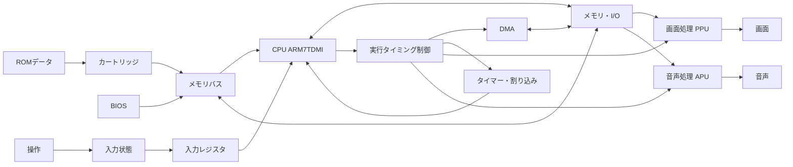

# GBAエミュレータの設計

## パイプライン



## AIが出力したメモ

``` Codex
Q.GBAエミュレータ作成において、何を作る必要がある？

A.GBAエミュレータは、ゲーム機の各部品をソフトウェアで再現するものです。
大きく分けると、CPU・メモリ・画面・音・入力・カートリッジを実装し、
それらを決められたタイミングで動かします。

## 主な構成要素

1. CPU（ARM7TDMI）
   - ARM命令とThumb命令の実行
   - レジスタ、フラグ、例外、割り込み
   - 命令ごとのサイクル数
2. メモリとアドレスマップ
   - BIOS、外部・内部RAM、VRAM、パレット、OAM、I/Oレジスタ
   - 読み書き時の動作や制限
   - ROMやセーブ領域へのアクセスを仲介するバス
3. 画面（PPU）
   - 画面モード、背景、タイル、スクロール
   - スプライト（OBJ）、ウィンドウ、色効果
   - HBlank・VBlankなどの走査タイミングと描画
4. タイマーと割り込み
   - タイマーのカウント・周期
   - VBlank、HBlank、タイマー、キー入力などの割り込み
   - CPUと各機能の同期
5. 入力
   - キーボードやゲームパッドをGBAのキー状態へ変換
   - キー割り込み
6. 音（APU）
   - 4つの従来型サウンドチャンネル
   - Direct Sound（FIFO、DMA連携）
   - サンプリングとホスト音声出力
7. カートリッジ
   - ROM読み込み、ROM領域のバンクや読み出し
   - SRAM・Flash・EEPROMなどのセーブ方式
   - ゲームによっては追加チップへの対応
8. DMA
   - メモリ間転送と開始条件（即時、VBlank、HBlank、音声など）
   - CPUや画面・音とのタイミング調整
9. 実行基盤とデバッグ
   - ROM起動、フレーム実行、画面・音声・入力の接続
   - ログ、命令トレース、ブレークポイント
   - テストROMや既知のテストで各機能を確認

## 作る順番の一例

まずは

ROM読み込み
 → メモリマップ
 → CPUの基本命令
 → 最小限の画面表示
 → 入力
 → 割り込み・DMA・タイマー
 → 音・セーブ対応 
 
の順で進めると、段階ごとに動作を確かめやすいです。
実際にはCPUだけでなく、画面やDMAもタイミング依存のため、各部品をつなぐ実行スケジューラが重要になります。

最初から全ゲーム対応を狙うより、対象を絞って機能を一つずつ追加し、テストROMやゲームで互換性を確認するのが現実的です。

```
